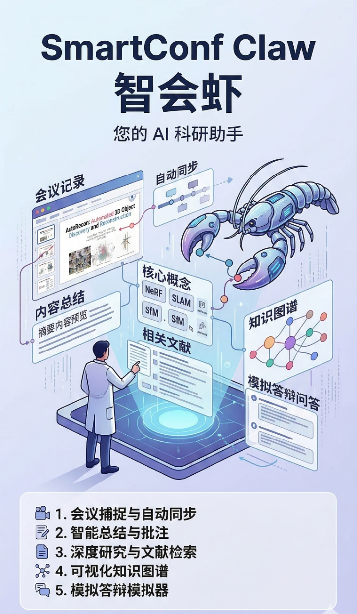

# SmartConf Claw (学术领航虾)

> A bilingual desktop AI academic copilot built for the OpenClaw Agent Hackathon.
>
> Your AI Academic Co-Pilot.

## Overview / 概览

SmartConf Claw is a desktop AI assistant for online academic conferences. It lets you select a screen region, captures presentation content, transcribes audio (ASR), then generates structured summaries, key concepts, knowledge graphs, and PhD-style Q&A practice.

智会虾（SmartConf Claw）是一个全流程会议托管助手。你只需要选择屏幕区域，它会捕获演示内容、完成语音转写（ASR），并自动生成结构化总结、关键概念、知识图谱以及博士面试/答辩风格的问答训练题。

## Demo Video / 演示视频

- [Bilibili: SmartConfClaw 智会虾：基于OpenClaw的多模态会议助手](https://www.bilibili.com/video/BV18HA5zjEaY/)
- [SmartConf Claw Demo: Your AI Academic Co-Pilot](https://youtu.be/AK2FVnlIMCk)

## Documentation / 说明文档

- [Notion: SmartConf-Claw（说明）](https://necessary-beast-2f1.notion.site/SmartConf-Claw-3268e8c2bbba80a1bab6ea2f68c4b42b?source=copy_link)

## Screenshot Gallery / 截图展示

### Meeting Capture / 会议捕获

中文：选择截屏区域后自动捕获 PPT 画面，并与音频转写进行时间对齐。

English: After selecting a region, it captures presentation slides and aligns them with the audio transcript.

### AI Analysis / AI 分析

中文：基于转写文本 + 截图进行总结、概念解析、标签抽取与结构化输出。

English: Analyze both transcript text and screenshots to produce summaries, concept explanations, tags, and structured outputs.

### Related Papers & Articles / 相关论文与文章

中文：根据会议内容，自动生成相关顶会论文/公众号文章列表，便于延伸阅读。

English: Automatically compile related papers/articles based on the session for deeper reading.

### Knowledge Graph / 知识图谱

中文：把跨会话的内容要素（方法、数据集、指标、作者等）抽取并可视化为可点击知识图谱。

English: Extract and visualize entities across sessions into a clickable knowledge graph.

### Q&A Simulator / Q&A 模拟器

中文：把被动听会变成主动训练，生成面试/答辩风格的问题，并给出建议回答要点。

English: Turn passive listening into active practice with PhD-style questions and suggested answer points.

### Flexible Settings / 灵活设置

中文：可配置截屏频率、转写与分析相关行为，让捕获更贴合你的会议节奏。

English: Configure capture interval and related analysis behavior to match your conference rhythm.

## Key Features / 核心功能

- Smart Capture & Auto-Sync: 选择截屏区域，自动对齐 PPT 截图与实时音频转写（ASR）。
- Summaries & Key Concepts: 总结章节要点，并提炼复杂学术概念，提供可悬浮查看的解释。
- Related Literature Retrieval: 基于会议内容检索相关论文/文章，支持延伸阅读清单。
- Interactive Knowledge Graph: 将跨会话内容结构化并渲染为知识图谱。
- Q&A Simulator: 生成博士面试/答辩问题，帮助你快速形成答题框架。
- Privacy-first workflow: 本地侧能力支持（如本地 ASR / 本地推理），尽量降低数据外泄风险。

## Tech Stack / 技术栈

- Frontend: React 18, TypeScript, TailwindCSS, shadcn/ui
- Desktop Core: Tauri 2.0 (Rust)
- Visualization: React Flow
- State Management: Zustand

## Getting Started / 快速开始

Requirements (macOS): Xcode Command Line Tools (`xcode-select --install`, also builds the Swift capture helper), Rust, Node/Bun, and `ffmpeg` (`brew install ffmpeg`).

1. Install dependencies: `npm install`
2. Start in dev mode: `npm run tauri:dev`
3. Grant **Screen Recording** permission when asked (window capture and system audio need it).

## Recording a meeting / 录制会议

**English**

- **Join a meeting** (Capture page): paste a Zoom / Teams / Google Meet / Tencent Meeting link — or the whole invitation text. Zoom and Teams links open straight in the desktop client. The app waits for the meeting window, then records it in the background. You can also **schedule** a link: it is joined one minute before the start time while the app is running. The local bot endpoint (`POST /v1/meeting`) uses the same flow.
- **Meeting window (background)** capture records one app window with `screencapture -l`, so it keeps working while other windows cover it — you can do other work. Don't minimize the meeting window. If the client recreates its window (e.g. switching to share view) the recorder follows it, and with *Stop automatically when the meeting window closes* the session ends when the meeting ends. *Full-screen desktop* and *Region* modes are still available.
- **Meeting audio without BlackHole**: on macOS 13+ the bundled helper (`src-tauri/helper/CaptureHelper.swift`, ScreenCaptureKit) records what the Mac plays directly — no virtual driver, no changing the sound output. Turn on *Also record my microphone* to mix in your mic. On older macOS the devices selected in Settings (e.g. BlackHole) are used as before.
- **Live transcript**: with an ASR endpoint configured (whisper.cpp server or OpenAI-compatible), audio is transcribed in ~10 s chunks while recording; captions appear on the Capture page and on the floating bar. When you stop, `transcript.txt` is already done (and *Auto-generate AI summary* can run the analysis automatically). *Transcribe* re-transcribes a recording in 30 s chunks, so long meetings no longer hit upload size limits.
- **Slide detection**: a screenshot is kept only when the picture changed and then settled. Webcam tiles / video areas that change constantly are ignored, transitions are captured once in their final state, and going back to a recent slide does not create a duplicate.
- **Export Markdown**: writes meeting minutes — summary, key points / decisions / action items, each slide with what was said while it was shown, concepts, references and Q&A — plus a `<name>_assets/` folder with the screenshots.

**中文**

- **加入会议**（会议捕获页）：粘贴 Zoom / Teams / Google Meet / 腾讯会议链接（或整段邀请文字）。Zoom、Teams 会直接在客户端打开；应用会等待会议窗口出现，然后在后台录制该窗口。也可以**定时加入**：应用运行时会在开始前 1 分钟自动入会。本机机器人接口（`POST /v1/meeting`）走同样的流程。
- **会议窗口（后台）** 模式用 `screencapture -l` 只录制会议窗口，即使被其它窗口挡住也能录，你可以同时做别的事（请勿最小化会议窗口）。会议软件重建窗口时会自动跟随；开启「会议窗口关闭后自动停止」后，会议结束即自动停止。仍保留「全屏桌面」与「框选区域」模式。
- **无需 BlackHole 录会议声音**：macOS 13+ 上，内置助手（ScreenCaptureKit）直接录制电脑播放的声音，无需虚拟声卡、无需切换输出设备。勾选「同时录制我的麦克风」可混入麦克风。旧版 macOS 仍使用设置中选择的设备（如 BlackHole）。
- **实时转写**：配置 ASR（whisper.cpp 或 OpenAI 兼容接口）后，录制时每约 10 秒转写一段，字幕显示在页面和悬浮条上；停止时转写稿已完成，可自动生成 AI 摘要。「语音转写」按钮按 30 秒分段重新转写，长会议不再超出上传大小限制。
- **翻页检测**：画面变化并稳定后才保存一页；持续变化的视频小窗会被忽略，转场动画只保存最终画面，翻回最近的页面不会重复保存。
- **导出 Markdown**：生成会议纪要（摘要、要点/结论/待办、每页幻灯片及对应讲解、概念、参考文献、问答），截图保存在同名 `_assets` 文件夹中。

## License / 许可协议

MIT License. See `LICENSE` for details.
